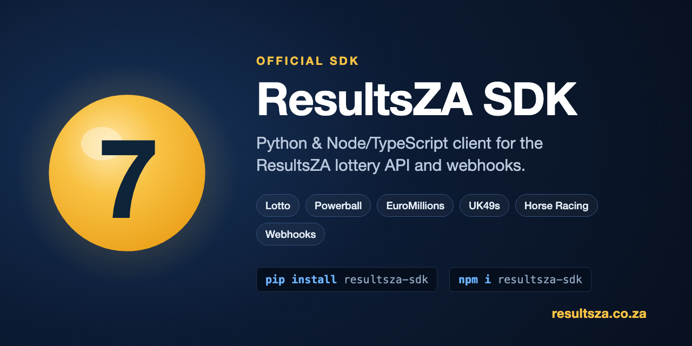

<p align="center">
  <a href="https://resultsza.co.za"></a>
</p>

<p align="center">
  <a href="LICENSE"></a>
  <a href="https://pypi.org/project/resultsza-sdk/"></a>
  <a href="https://www.npmjs.com/package/resultsza-sdk"></a>
  <a href="https://github.com/Stef1986/resultsza-sdk/stargazers"></a>
</p>

<p align="center">
  <em>Find it useful? Give it a ⭐ to help more developers discover the ResultsZA lottery API.</em>
</p>

The **ResultsZA SDK** is the official Python and Node/TypeScript client for the [**ResultsZA lottery API**](https://resultsza.co.za/api_docs). Fetch **Lotto, Powerball, EuroMillions, UK49s, Gosloto and horse racing results**, generate numbers, check played lines, and verify **lottery webhooks** in a few lines of code - across South Africa, Kenya, Nigeria, Ghana, the UK, Europe, the US and Russia.

Bring your own API key: **[create a free account](https://resultsza.co.za/signup)**, then generate the key in My Dashboard. Buy a plan at [resultsza.co.za/api-pricing](https://resultsza.co.za/api-pricing).

> **Disclaimer:** This is tooling for the ResultsZA API. It is not affiliated with the South African National Lottery, UK 49's, or any national lottery or horse racing operator. Results are provided for convenience, so always verify on the official operator's site before claiming a prize.

## Languages

| Language | Status | Package |
|---|---|---|
| **Python** | ✅ Available | [`python/`](python/) - `pip install resultsza-sdk` |
| **Node / TypeScript** | ✅ Available | [`node/`](node/) - `npm install resultsza-sdk` |

## Quickstart (Python)

```bash
pip install resultsza-sdk
```

```python
import os
from resultsza import ResultsZA

client = ResultsZA(api_key=os.environ["RESULTSZA_API_KEY"])

client.get_lotto_results()                       # latest SA Lotto draw
client.get_us_powerball_results(date="2026-07-08")
client.get_gosloto_6_45_results(date="2026-08-06")  # every draw that day
client.generate_random_numbers(game="Powerball", lines=5)
client.get_hot_cold_numbers(product="Lotto")
client.check_balance()                           # free - no calls used
```

Your API key is read from an argument or your own environment variable, never hardcoded, and it's redacted if it ever reaches a log or error. Full usage in the [Python README](python/README.md).

## Quickstart (Node / TypeScript)

```bash
npm install resultsza-sdk
```

```ts
import { ResultsZA } from "resultsza-sdk";

const client = new ResultsZA({ apiKey: process.env.RESULTSZA_API_KEY! });

await client.getLottoResults();                        // latest SA Lotto draw
await client.getGosloto645Results({ date: "2026-08-06" }); // every draw that day
await client.generateRandomNumbers({ game: "Powerball", lines: 5 });
await client.checkBalance();                            // free - no calls used
```

Ships ESM + CommonJS with TypeScript types, and has zero runtime dependencies. Full usage in the [Node README](node/README.md).

## What's covered

- **Lottery results** - SA (Daily Lotto, Lotto, Lotto Plus 1, Lotto 5 Max, Powerball, Powerball Xtra), Kenya, Nigeria, Ghana, UK 49's, EuroMillions, Irish Lotto, US Powerball, Mega Millions, Gosloto 6/45, Gosloto 7/49, Gosloto 5/36
- **Horse racing** - meetings, full race cards and single-race runner tables for all South African racecourses (e.g. Greyville, Kenilworth, Fairview, Turffontein, Vaal, Scottsville, Durbanville)
- **Number tools** - random generator (1 to 500 lines), deterministic text-to-lucky, hot/cold, frequencies, pairs, including Gosloto, Kenya Mega Jackpot and the individual Ghana and Nigeria Premier games
- **Checkers** - single (up to 10 lines) and bulk (up to 500 lines) for the SA games; the legacy Daily Lotto Plus, Lotto Plus 2 and Powerball Plus are accepted for draws before 2026-06-01
- **Account** - free balance & subscription status check
- **Webhooks** - HMAC-SHA256 signature verification and envelope parsing for consuming result pushes
- **Typed errors** - `QuotaExceededError`, `SubscriptionExpiredError`, `RateLimitError` (with `retry_after`) and more, plus client-side validation that rejects bad dates and parameters before a request is sent

See the [full endpoints table](python/README.md#supported-endpoints).

## Use with AI assistants (MCP)

The [`mcp/`](mcp/) folder holds the official ResultsZA MCP server, published on npm as
[`resultsza-mcp`](https://www.npmjs.com/package/resultsza-mcp). Add it to Claude Desktop, Cursor
or VS Code with your API key and your assistant can look up results, check numbers and get horse
racing results for you:

```json
{
  "mcpServers": {
    "resultsza": {
      "command": "npx",
      "args": ["-y", "resultsza-mcp"],
      "env": { "RESULTSZA_API_KEY": "YOUR_API_KEY" }
    }
  }
}
```

Setup for each assistant and the full tool list: [mcp/README.md](mcp/README.md) and
[resultsza.co.za/mcp](https://resultsza.co.za/mcp).

## Webhooks

ResultsZA can push results to your endpoint the moment they're published. Register your endpoint URL and get your signing secret in the **[subscriber portal](https://resultsza.co.za/portal/login)** under **Push Settings**; this SDK helps you receive and verify those deliveries safely: verify against raw bytes, respond within 10 seconds, and deduplicate at-least-once deliveries. See the [webhook docs](https://resultsza.co.za/webhook-docs) and the [Flask receiver example](python/examples/webhook_receiver_flask.py).

## API keys & pricing

Every request needs an API key tied to an active subscription. Create a free account, generate the key in My Dashboard, then pick a plan on the pricing page. Tiers range from Starter through Unlimited (60 req/min). Check current usage any time with `client.check_balance()`, which is free.

- 🔑 [Create a free account and get an API key](https://resultsza.co.za/signup)
- 💳 [Pricing & plans](https://resultsza.co.za/api-pricing)
- 🔔 [Set up webhooks (portal Push Settings)](https://resultsza.co.za/portal/login)
- 📚 [API documentation](https://resultsza.co.za/api_docs)
- 📬 [Webhook documentation](https://resultsza.co.za/webhook-docs)
- 🌍 [resultsza.co.za](https://resultsza.co.za)

## FAQ

**Is there a lottery API for South African and international results?**
Yes. The ResultsZA API is a lottery results API covering SA Lotto, Lotto Plus 1, Lotto 5 Max, Daily Lotto, Powerball and Powerball Xtra, plus UK49s, EuroMillions, Irish Lotto, US Powerball, Mega Millions, Gosloto (6/45, 7/49 and 5/36), and lotteries in Kenya, Nigeria and Ghana - as well as South African horse racing. This repository is the official Python and Node/TypeScript client for it.

**How do I get Lotto or Powerball results via API?**
Create a free account at [resultsza.co.za/signup](https://resultsza.co.za/signup), generate an API key in My Dashboard, install the SDK (`pip install resultsza-sdk` or `npm install resultsza-sdk`), and call a method such as `get_lotto_results()` or `get_sa_powerball_results()`. See the Quickstart above.

**How do I verify a ResultsZA lottery webhook?**
The SDK ships HMAC-SHA256 webhook signature verification. Pass the raw request bytes and the `X-ResultsZA-Signature` header to `verify_webhook_signature(...)` (or `verify_and_parse(...)`) - see the Webhooks section. This is the safe way to consume a lottery results webhook.

**Which languages does the SDK support?**
Python (3.9+) and Node / TypeScript (20+), from a single repository, with matching features and typed clients.

## Contributing

Issues and pull requests are welcome. Tests mock the HTTP layer, so you can run the full suite without an API key:

```bash
pip install -e "python/[dev]"
cd python && pytest
```

Security issues: please see [SECURITY.md](SECURITY.md) rather than opening a public issue.

## License

[MIT](LICENSE)
